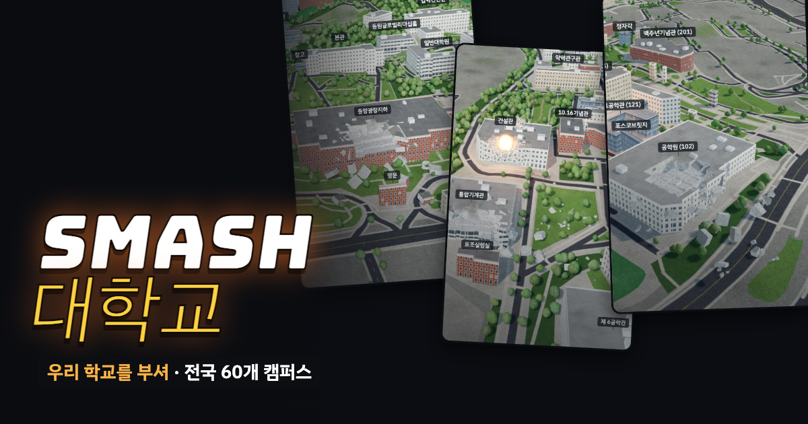

# SMASH 대학교

우리 학교 캠퍼스를 3D로 부수는 게임을 모아 둔 첫 화면입니다. 학교와 관계없는 비공식 팬 게임입니다.

**바로 가기:** https://hong-iron.github.io/SMASH/

## 학교

| 학교 | 게임 | 소스 |
|---|---|---|
| 강원대학교 강릉캠퍼스 | https://hong-iron.github.io/SMASH-KANGWON-GANGNEUNG/ | [SMASH-KANGWON-GANGNEUNG](https://github.com/Hong-Iron/SMASH-KANGWON-GANGNEUNG) |
| 강원대학교 도계캠퍼스 | https://hong-iron.github.io/SMASH-KANGWON-DOGYE/ | [SMASH-KANGWON-DOGYE](https://github.com/Hong-Iron/SMASH-KANGWON-DOGYE) |
| 강원대학교 삼척캠퍼스 | https://hong-iron.github.io/SMASH-KANGWON-SAMCHEOK/ | [SMASH-KANGWON-SAMCHEOK](https://github.com/Hong-Iron/SMASH-KANGWON-SAMCHEOK) |
| 강원대학교 원주캠퍼스 | https://hong-iron.github.io/SMASH-KANGWON-WONJU/ | [SMASH-KANGWON-WONJU](https://github.com/Hong-Iron/SMASH-KANGWON-WONJU) |
| 강원대학교 춘천캠퍼스 | https://hong-iron.github.io/SMASH-KANGWON/ | [SMASH-KANGWON](https://github.com/Hong-Iron/SMASH-KANGWON) |
| 건국대학교 글로컬캠퍼스 | https://hong-iron.github.io/SMASH-KONKUK-GLOCAL/ | [SMASH-KONKUK-GLOCAL](https://github.com/Hong-Iron/SMASH-KONKUK-GLOCAL) |
| 건국대학교 서울캠퍼스 | https://hong-iron.github.io/SMASH-KONKUK/ | [SMASH-KONKUK](https://github.com/Hong-Iron/SMASH-KONKUK) |
| 경동대학교 메디컬캠퍼스 | https://hong-iron.github.io/SMASH-KDU-WONJU/ | [SMASH-KDU-WONJU](https://github.com/Hong-Iron/SMASH-KDU-WONJU) |
| 경동대학교 메트로폴캠퍼스 | https://hong-iron.github.io/SMASH-KDU-YANGJU/ | [SMASH-KDU-YANGJU](https://github.com/Hong-Iron/SMASH-KDU-YANGJU) |
| 경동대학교 설악캠퍼스 | https://hong-iron.github.io/SMASH-KDU-SEORAK/ | [SMASH-KDU-SEORAK](https://github.com/Hong-Iron/SMASH-KDU-SEORAK) |
| 경북대학교 대구캠퍼스 | https://hong-iron.github.io/SMASH-KNU/ | [SMASH-KNU](https://github.com/Hong-Iron/SMASH-KNU) |
| 경북대학교 상주캠퍼스 | https://hong-iron.github.io/SMASH-KNU-SANGJU/ | [SMASH-KNU-SANGJU](https://github.com/Hong-Iron/SMASH-KNU-SANGJU) |
| 경희대학교 광릉캠퍼스 | https://hong-iron.github.io/SMASH-KHU-GWANGNEUNG/ | [SMASH-KHU-GWANGNEUNG](https://github.com/Hong-Iron/SMASH-KHU-GWANGNEUNG) |
| 경희대학교 국제캠퍼스 | https://hong-iron.github.io/SMASH-KHU-GLOBAL/ | [SMASH-KHU-GLOBAL](https://github.com/Hong-Iron/SMASH-KHU-GLOBAL) |
| 경희대학교 서울캠퍼스 | https://hong-iron.github.io/SMASH-KHU/ | [SMASH-KHU](https://github.com/Hong-Iron/SMASH-KHU) |
| 고려대학교 서울캠퍼스 | https://hong-iron.github.io/SMASH-KU/ | [SMASH-KU](https://github.com/Hong-Iron/SMASH-KU) |
| 고려대학교 세종캠퍼스 | https://hong-iron.github.io/SMASH-KU-SEJONG/ | [SMASH-KU-SEJONG](https://github.com/Hong-Iron/SMASH-KU-SEJONG) |
| 국립부경대학교 대연캠퍼스 | https://hong-iron.github.io/SMASH-PKNU/ | [SMASH-PKNU](https://github.com/Hong-Iron/SMASH-PKNU) |
| 국립부경대학교 용당캠퍼스 | https://hong-iron.github.io/SMASH-PKNU-YONGDANG/ | [SMASH-PKNU-YONGDANG](https://github.com/Hong-Iron/SMASH-PKNU-YONGDANG) |
| 국민대학교 | https://hong-iron.github.io/SMASH-KMU/ | [SMASH-KMU](https://github.com/Hong-Iron/SMASH-KMU) |
| 동국대학교 WISE캠퍼스 | https://hong-iron.github.io/SMASH-DGU-WISE/ | [SMASH-DGU-WISE](https://github.com/Hong-Iron/SMASH-DGU-WISE) |
| 동국대학교 서울캠퍼스 | https://hong-iron.github.io/SMASH-DGU/ | [SMASH-DGU](https://github.com/Hong-Iron/SMASH-DGU) |
| 동아방송예술대학교 | https://hong-iron.github.io/SMASH-DIMA/ | [SMASH-DIMA](https://github.com/Hong-Iron/SMASH-DIMA) |
| 동의대학교 가야캠퍼스 | https://hong-iron.github.io/SMASH-DEU/ | [SMASH-DEU](https://github.com/Hong-Iron/SMASH-DEU) |
| 부산대학교 밀양캠퍼스 | https://hong-iron.github.io/SMASH-PNU-MIRYANG/ | [SMASH-PNU-MIRYANG](https://github.com/Hong-Iron/SMASH-PNU-MIRYANG) |
| 부산대학교 부산캠퍼스 | https://hong-iron.github.io/SMASH-PNU/ | [SMASH-PNU](https://github.com/Hong-Iron/SMASH-PNU) |
| 부산대학교 양산캠퍼스 | https://hong-iron.github.io/SMASH-PNU-YANGSAN/ | [SMASH-PNU-YANGSAN](https://github.com/Hong-Iron/SMASH-PNU-YANGSAN) |
| 서강대학교 | https://hong-iron.github.io/SMASH-SOGANG/ | [SMASH-SOGANG](https://github.com/Hong-Iron/SMASH-SOGANG) |
| 서울대학교 관악캠퍼스 | https://hong-iron.github.io/SMASH-SNU/ | [SMASH-SNU](https://github.com/Hong-Iron/SMASH-SNU) |
| 서울대학교 시흥캠퍼스 | https://hong-iron.github.io/SMASH-SNU-SIHEUNG/ | [SMASH-SNU-SIHEUNG](https://github.com/Hong-Iron/SMASH-SNU-SIHEUNG) |
| 서울대학교 연건캠퍼스 | https://hong-iron.github.io/SMASH-SNU-YEONGEON/ | [SMASH-SNU-YEONGEON](https://github.com/Hong-Iron/SMASH-SNU-YEONGEON) |
| 서울대학교 평창캠퍼스 | https://hong-iron.github.io/SMASH-SNU-PYEONGCHANG/ | [SMASH-SNU-PYEONGCHANG](https://github.com/Hong-Iron/SMASH-SNU-PYEONGCHANG) |
| 서울시립대학교 | https://hong-iron.github.io/SMASH-UOS/ | [SMASH-UOS](https://github.com/Hong-Iron/SMASH-UOS) |
| 성균관대학교 인문사회과학캠퍼스 | https://hong-iron.github.io/SMASH-SKKU/ | [SMASH-SKKU](https://github.com/Hong-Iron/SMASH-SKKU) |
| 성균관대학교 자연과학캠퍼스 | https://hong-iron.github.io/SMASH-SKKU-SUWON/ | [SMASH-SKKU-SUWON](https://github.com/Hong-Iron/SMASH-SKKU-SUWON) |
| 세종대학교 | https://hong-iron.github.io/SMASH-SEJONG/ | [SMASH-SEJONG](https://github.com/Hong-Iron/SMASH-SEJONG) |
| 숙명여자대학교 | https://hong-iron.github.io/SMASH-SOOKMYUNG/ | [SMASH-SOOKMYUNG](https://github.com/Hong-Iron/SMASH-SOOKMYUNG) |
| 숭실대학교 캠퍼스 | https://hong-iron.github.io/SMASH-SSU/ | [SMASH-SSU](https://github.com/Hong-Iron/SMASH-SSU) |
| 연세대학교 국제캠퍼스 | https://hong-iron.github.io/SMASH-YONSEI-INTL/ | [SMASH-YONSEI-INTL](https://github.com/Hong-Iron/SMASH-YONSEI-INTL) |
| 연세대학교 미래캠퍼스 | https://hong-iron.github.io/SMASH-YONSEI-MIRAE/ | [SMASH-YONSEI-MIRAE](https://github.com/Hong-Iron/SMASH-YONSEI-MIRAE) |
| 연세대학교 신촌캠퍼스 | https://hong-iron.github.io/SMASH-YONSEI/ | [SMASH-YONSEI](https://github.com/Hong-Iron/SMASH-YONSEI) |
| 연세대학교 원주의과대학 | https://hong-iron.github.io/SMASH-YONSEI-WMED/ | [SMASH-YONSEI-WMED](https://github.com/Hong-Iron/SMASH-YONSEI-WMED) |
| 이화여자대학교 | https://hong-iron.github.io/SMASH-EWHA/ | [SMASH-EWHA](https://github.com/Hong-Iron/SMASH-EWHA) |
| 인하대학교 | https://hong-iron.github.io/SMASH-INHA/ | [SMASH-INHA](https://github.com/Hong-Iron/SMASH-INHA) |
| 전남대학교 광주캠퍼스 | https://hong-iron.github.io/SMASH-JNU/ | [SMASH-JNU](https://github.com/Hong-Iron/SMASH-JNU) |
| 전남대학교 국동캠퍼스 | https://hong-iron.github.io/SMASH-JNU-GUKDONG/ | [SMASH-JNU-GUKDONG](https://github.com/Hong-Iron/SMASH-JNU-GUKDONG) |
| 전남대학교 여수캠퍼스 | https://hong-iron.github.io/SMASH-JNU-YEOSU/ | [SMASH-JNU-YEOSU](https://github.com/Hong-Iron/SMASH-JNU-YEOSU) |
| 전남대학교 학동캠퍼스 | https://hong-iron.github.io/SMASH-JNU-HAKDONG/ | [SMASH-JNU-HAKDONG](https://github.com/Hong-Iron/SMASH-JNU-HAKDONG) |
| 전남대학교 화순캠퍼스 | https://hong-iron.github.io/SMASH-JNU-HWASUN/ | [SMASH-JNU-HWASUN](https://github.com/Hong-Iron/SMASH-JNU-HWASUN) |
| 조선대학교 | https://hong-iron.github.io/SMASH-CHOSUN/ | [SMASH-CHOSUN](https://github.com/Hong-Iron/SMASH-CHOSUN) |
| 중앙대학교 다빈치캠퍼스 | https://hong-iron.github.io/SMASH-CAU-DAVINCI/ | [SMASH-CAU-DAVINCI](https://github.com/Hong-Iron/SMASH-CAU-DAVINCI) |
| 중앙대학교 서울캠퍼스 | https://hong-iron.github.io/SMASH-CAU/ | [SMASH-CAU](https://github.com/Hong-Iron/SMASH-CAU) |
| 한경국립대학교 안성캠퍼스 | https://hong-iron.github.io/SMASH-HKNU/ | [SMASH-HKNU](https://github.com/Hong-Iron/SMASH-HKNU) |
| 한국공학대학교 | https://hong-iron.github.io/SMASH-TUKOREA/ | [SMASH-TUKOREA](https://github.com/Hong-Iron/SMASH-TUKOREA) |
| 한국외국어대학교 글로벌캠퍼스 | https://hong-iron.github.io/SMASH-HUFS-GLOBAL/ | [SMASH-HUFS-GLOBAL](https://github.com/Hong-Iron/SMASH-HUFS-GLOBAL) |
| 한국외국어대학교 서울캠퍼스 | https://hong-iron.github.io/SMASH-HUFS/ | [SMASH-HUFS](https://github.com/Hong-Iron/SMASH-HUFS) |
| 한양대학교 ERICA캠퍼스 | https://hong-iron.github.io/SMASH-HYU-ERICA/ | [SMASH-HYU-ERICA](https://github.com/Hong-Iron/SMASH-HYU-ERICA) |
| 한양대학교 서울캠퍼스 | https://hong-iron.github.io/SMASH-HYU/ | [SMASH-HYU](https://github.com/Hong-Iron/SMASH-HYU) |
| 홍익대학교 서울캠퍼스 | https://hong-iron.github.io/SMASH-HONGIK/ | [SMASH-HONGIK](https://github.com/Hong-Iron/SMASH-HONGIK) |
| 홍익대학교 세종캠퍼스 | https://hong-iron.github.io/SMASH-HONGIK-SEJONG/ | [SMASH-HONGIK-SEJONG](https://github.com/Hong-Iron/SMASH-HONGIK-SEJONG) |

부수고 싶은 학교가 있으면 [이슈](https://github.com/Hong-Iron/SMASH/issues/new)로 알려 주세요.

## 학교 추가하는 법

1. 학교 게임 레포를 하나 만듭니다(기존 레포를 복사해 `config.json`과 데이터만 바꿈).
2. 이 레포의 `schools.json`에 학교를 한 줄 넣습니다(`code`, `name`, `campus`, `nameEn`, `region`, `url`, `buildings`, `added`). 허브의 검색은 이름·지역·영문·초성으로, 정렬은 이름순·최근 추가순·건물 많은 순으로 됩니다.
3. `python3 tools/build.py`로 `site/index.html`을 다시 만들고 `main`에 push하면 GitHub Pages에 올라갑니다.

## 앱 아이콘

폭탄과 폭발을 그린 아이콘입니다. 원본은 `assets/icon.svg`이고, 크기별 PNG는 `site/icon-1024.png`, `icon-512.png`, `icon-180.png`(홈 화면), `icon-128.png`, `icon-32.png`(브라우저 탭)입니다.

## 개발자 응원하기

- 카카오페이: https://qr.kakaopay.com/FKcOJKyOy1f405462
- Buy Me a Coffee: https://buymeacoffee.com/hongiron

건물·도로 © OpenStreetMap 기여자 (ODbL) · 고도 AWS Terrain Tiles (SRTM 30 m 기반)
